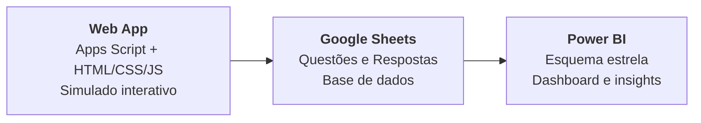

# ENADE Analytics

**Plataforma de simulado e Business Intelligence para apoio à preparação ao ENADE 2026.**


Projeto desenvolvido como requisito parcial de avaliação da disciplina de **Business Intelligence** do curso de **Gestão da Tecnologia da Informação** do **Instituto Federal do Paraná (IFPR) — Campus Pinhais**.

---

## Sumário

- [Visão geral](#visão-geral)
- [Objetivos analíticos](#objetivos-analíticos)
- [Arquitetura](#arquitetura)
- [Tecnologias](#tecnologias)
- [Estrutura do repositório](#estrutura-do-repositório)
- [Como executar](#como-executar)
- [Privacidade e conformidade com a LGPD](#privacidade-e-conformidade-com-a-lgpd)
- [Documentação](#documentação)
- [Roadmap](#roadmap)
- [Equipe](#equipe)
- [Licença](#licença)

---

## Visão geral

A coordenação do curso precisa direcionar ações de reforço pedagógico antes da prova oficial do INEP, mas nem sempre dispõe de dados objetivos sobre onde estão as maiores dificuldades dos concluintes. O **ENADE Analytics** responde a essa necessidade com uma solução de ponta a ponta, construída a partir de dados coletados em simulados-piloto:

1. **Simulado interativo (Web App):** o aluno responde às questões usando um ID anônimo de sua escolha e recebe feedback imediato de acertos e erros.
2. **Base de dados:** banco de questões e registro de respostas estruturados no Google Sheets.
3. **Dashboard analítico (Power BI):** visões separadas para **Alunos** (acompanhamento da própria evolução) e **Professores/Coordenação** (análise agregada), sustentadas por um modelo dimensional em esquema estrela.

---

## Objetivos analíticos

- Identificar os **eixos temáticos** com pior desempenho médio entre os concluintes.
- Comparar o desempenho entre **turmas e períodos**.
- Verificar se as lacunas de conhecimento estão **concentradas em poucos alunos** ou **distribuídas pela turma** (análise de dispersão e desvio padrão).
- Avaliar se o desempenho **evolui ao longo do semestre** conforme novos simulados são aplicados.
- Correlacionar o **tempo de resposta** com a **taxa de acertos**.

---

## Arquitetura



---

## Tecnologias

| Camada | Ferramenta |
|--------|------------|
| Front-end do simulado | HTML, CSS e JavaScript |
| Back-end do simulado | Google Apps Script |
| Armazenamento | Google Sheets |
| Modelagem e visualização | Power BI Desktop |
| Versionamento | Git e GitHub |

---

## Estrutura do repositório

```text
ENADE-Analytics---BI/
├── 01. Documentação/
│   ├── Marco 0 - Termo de Abertura.pdf
│   ├── Marco 1 - Matriz de Requisitos.pdf
│   ├── Marco 1 - Termo de Consentimento LGPD.pdf
│   └── Marco 2 - Modelo de Dados DW.pdf
│
├── 02. Formulário/
│   ├── backend/
│   │   └── code.gs
│   ├── frontend/
│   │   ├── index.html
│   │   ├── style.html
│   │   └── javascript.html
│   └── README-formulario.md
│
├── 03. Dados e DW/
│   ├── ENADE Analytics - Banco de Questões.xlsx
│   └── ENADE Analytics - Registro de Respostas.xlsx
│
├── 04. Dashboard/
│   └── ENADE Analytics - Fogo e Dados.pbix
│
└── README.md
```

---

## Como executar

**Simulado (Web App):** as instruções de implantação no Google Apps Script estão em [`02. Formulário/README-formulario.md`](./02.%20Formulário/README-formulario.md).

**Dashboard:** abra o arquivo `04. Dashboard/ENADE Analytics - Fogo e Dados.pbix` no **Power BI Desktop** (disponível para Windows). Para atualizar os dados, aponte a fonte para a planilha de respostas em `03. Dados e DW/`.

---

## Privacidade e conformidade com a LGPD

O projeto foi desenvolvido seguindo os princípios da **Lei Geral de Proteção de Dados (Lei nº 13.709/2018)**, em especial os de finalidade, necessidade e minimização:

- **Sem dados pessoais identificáveis:** não são coletados nome, CPF ou e-mail.
- **ID anônimo:** cada aluno escolhe o próprio identificador, o que permite acompanhar sua evolução sem identificá-lo.
- **Consentimento:** o Termo de Consentimento Livre e Esclarecido (TCLE) é apresentado antes do início do simulado.
- **Análise agregada:** na visão de Professores/Coordenação, os dados são exibidos de forma agregada, sem exposição do ID individual.
- **Finalidade educacional:** os resultados não substituem nem representam o desempenho no ENADE oficial do INEP.

---

## Documentação

Os entregáveis do Projeto Integrador estão em [`01. Documentação/`](./01.%20Documentação):

| Marco | Documento |
|-------|-----------|
| Marco 0 | Termo de Abertura do Projeto |
| Marco 1 | Matriz de Requisitos |
| Marco 1 | Termo de Consentimento LGPD |
| Marco 2 | Modelo de Dados (Data Warehouse) |

---

## Roadmap

- [x] Estruturação do banco de questões
- [x] Desenvolvimento do Web App de simulado
- [x] Coleta de dados em conformidade com a LGPD
- [x] Modelagem dimensional (esquema estrela)
- [x] Dashboard interativo no Power BI
- [ ] Apresentação final

---

## Equipe

| Nome | Função |
|------|--------|
| Ava Moreira de Lima | Desenvolvimento e análise |
| Milena Pianaro Caetano | Desenvolvimento e análise |
| Vinícius Andrade Henrique | Desenvolvimento e análise |

**Orientadora:** Prof.ª Lauriana Paludo
**Instituição:** Instituto Federal do Paraná — Campus Pinhais

---

## Licença

Projeto acadêmico desenvolvido para fins educacionais. O uso é restrito ao contexto do Projeto Integrador do curso de Gestão da Tecnologia da Informação do IFPR — Campus Pinhais.
